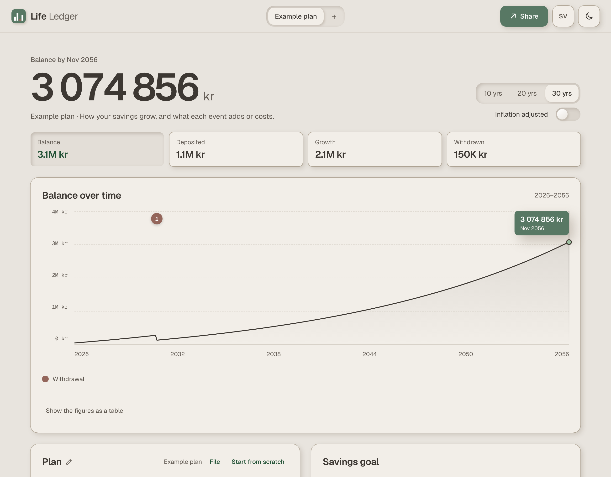

# Life Ledger

A free, browser-based long-term financial planner that shows what a big decision, like taking money out of savings for a car or a home, really costs years later.

**Live:** https://jbarte.github.io/advanced-savings-calculator/ (the address keeps the project's first name, so existing links keep working).



## What it does

You enter a start amount, a monthly deposit, an expected return and a time horizon, then add events to the plan: withdrawals on specific dates, one-time deposits, and raises, cuts or pauses in your monthly saving. Every event is drawn on the chart and shows how much it changes your end balance. You can also set a savings goal and see the monthly deposit it needs, keep up to five plans as tabs and compare them side by side, view results adjusted for inflation, and share a plan with a link or download it as a file. Everything stays in your browser, and the app is available in English and Swedish.

## Getting started

### Requirements

- Node.js 22.12 or newer
- No external services, accounts or API keys

### Installation

```bash
git clone https://github.com/jbarte/advanced-savings-calculator
cd advanced-savings-calculator
npm install
```

### Configuration

None. There are no environment variables, secrets or `.env` file: the app has no backend and makes no network requests.

### Run

```bash
npm run dev
```

Open http://localhost:5173/advanced-savings-calculator/. Other commands:

| Command | What it does |
|---|---|
| `npm test` | Run the unit tests once |
| `npm run test:watch` | Rerun the tests when files change |
| `npm run typecheck` | Run the strict TypeScript check |
| `npm run build` | Typecheck and build the static site to `dist/` |
| `npm run preview` | Serve the built site locally |

## Architecture

The code is split into three layers that only depend inwards: `ui → state → core`. `core` is a pure calculation engine (the monthly projection, the effect of each event and the goal solver), with no DOM, clock or I/O. `state` holds the plan as one versioned document, builds the view the UI draws, and is the only place that touches `localStorage` and the URL. `ui` renders the DOM and handles events without any financial math, and `main.ts` wires the store, the actions and the rendering together. Money is stored as whole öre (integers), never as floats, and a test enforces the layer rules.

```
/
├── src/
│   ├── core/       # Pure calculation engine, fully unit-tested
│   ├── state/      # The plan document, validation, storage, share links, view model
│   ├── ui/         # DOM rendering and events, plus all interface text (English and Swedish)
│   ├── styles/     # Design tokens and component styles
│   └── main.ts     # Entry point: store, actions and rendering
├── public/         # Favicon, link-preview image and the self-hosted fonts
├── docs/           # The screenshot above
├── .github/        # CI workflow and Dependabot
├── CLAUDE.md       # Architecture, conventions and rules in detail
├── NEXT_STEPS.md   # Roadmap and open ideas
└── implementation.md  # Log of what was built, why and how it was checked
```

## Tech stack

| Component | Choice | Why |
|---|---|---|
| Language | TypeScript (strict) | Dates, amounts and rates must never get mixed up in financial math |
| UI | Vanilla DOM, no framework | The interface is small (forms, a chart, a table); a framework would add weight for little gain |
| Build and dev server | Vite | Fast dev server and a simple static build |
| Tests | Vitest | Unit tests for the engine and state, same config as Vite |
| Charts | Plain SVG | No chart library needed |
| Fonts | Geist, self-hosted | Fonts from Google would send every visitor's IP address to Google |
| CI and hosting | GitHub Actions and GitHub Pages | Free, and a static site needs no server; tests and build run on every pull request, deploy on `main` |

There are no runtime dependencies.

## Limitations

- **Estimates, not advice.** The calculations assume a constant return every year. Real markets vary, so a plan shows one possible path, not a forecast. The results are not financial advice.
- **No taxes or fees.** Returns are used as entered. Taxes, account types, fund fees and other currencies than SEK are not modelled, and amounts are whole kronor.
- **Monthly steps and fixed limits.** Dates have month precision, a plan runs 1 to 40 years, and there are caps: 50 withdrawals, 50 deposit changes, 10 one-time deposits and 5 plans of your own. The caps keep every amount exact.
- **Your data lives in one browser.** There is no account or sync, so clearing site data deletes your plans. Download a plan file or share a link to keep a copy.
- **The goal solver changes one thing.** It finds the base monthly deposit that reaches your goal and keeps all your events as they are. It doesn't optimise anything else.
- **Modern browsers only.** Compressed share links use the browser's built-in compression and fall back to uncompressed ones. There is no linter yet; it waits for typescript-eslint to support TypeScript 7.
- **Two languages.** The interface is in English and Swedish.

## Built with

Claude Code (agent-driven development) as part of the course Next-Generation Software Development with AI.
